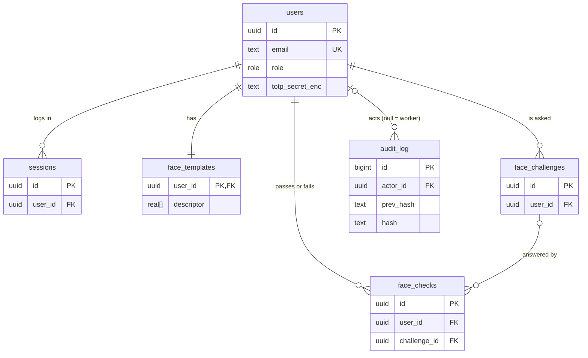
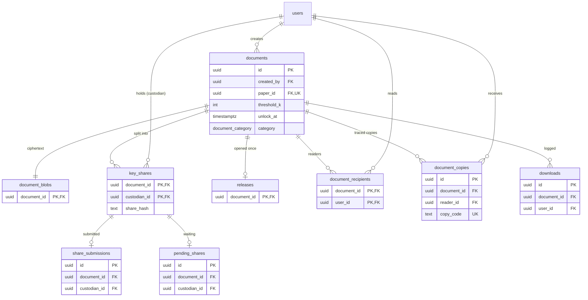
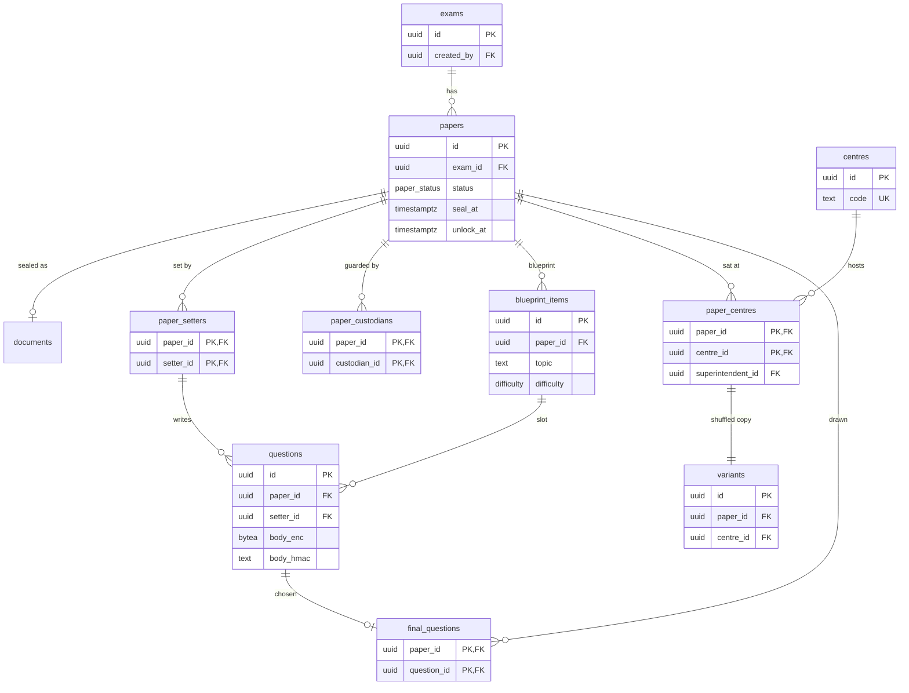
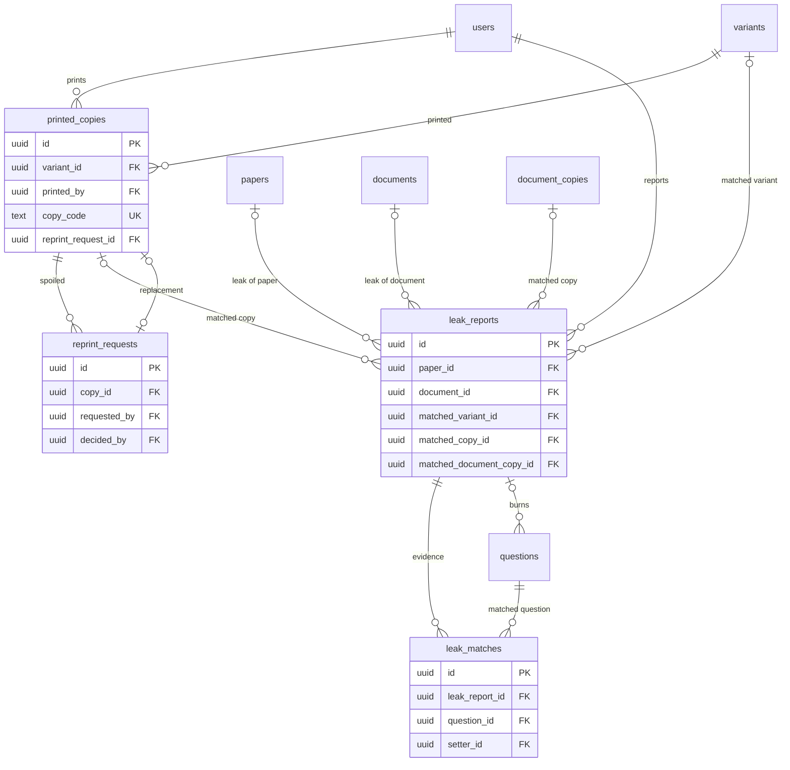

# SealedPaper ER diagrams

29 tables in four views. PK = primary key, FK = foreign key, UK = unique. `||--o{` = one to many, `||--||` = one to one, `|o--o{` = optional one to many.

## 1. Accounts, face checks and audit

## 2. Key vault (any confidential document)

## 3. Exam papers

## 4. Printing and leaks

Constraints, normalisation (1NF to BCNF) and the full relationship table are in the guide doc's "ER diagram and normalisation" tab.
